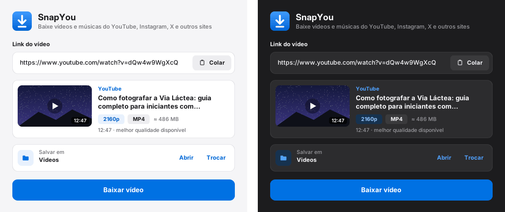
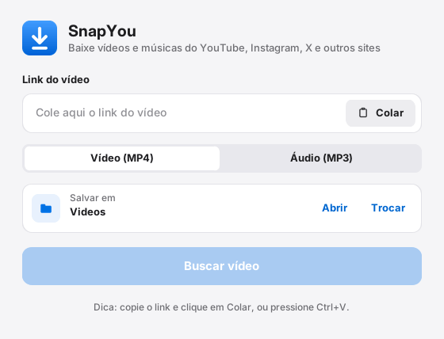
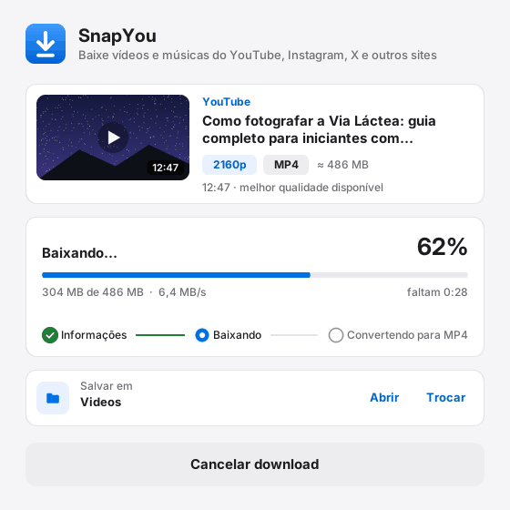
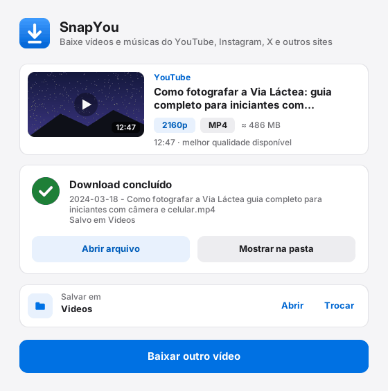
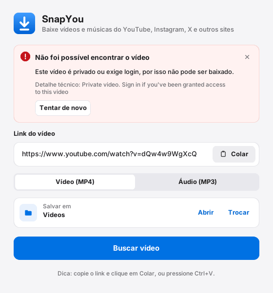

# SnapYou

SnapYou é um aplicativo de janela para Windows e Mac que baixa vídeos do YouTube (e de outros sites
suportados pelo [yt-dlp](https://github.com/yt-dlp/yt-dlp)) em **MP4**, ou só o áudio em **MP3**.
Cole o link, confira o vídeo encontrado e clique em **Baixar vídeo**.



- Visual claro e limpo, inspirado nas diretrizes de design da Apple, com **tema escuro automático**
  (segue o tema do Windows/Mac)
- Cores com contraste conferido pela WCAG 2.1 (nível AA) e fonte nativa de cada sistema
  (Segoe UI Variable no Windows 11, San Francisco no Mac)
- Cartão com miniatura, origem, título, duração, melhor qualidade, formato e tamanho estimado antes de baixar
- Vídeo (MP4) ou só áudio (MP3), cada um com a sua pasta de destino
- Progresso com porcentagem, quantidade baixada, velocidade, tempo restante e etapas
- **Cancelar download** a qualquer momento (os arquivos incompletos são apagados)
- Avisos de erro dentro da janela, em português claro, com botão **Tentar de novo**
- Tela de conclusão com **Abrir arquivo** e **Mostrar na pasta**
- Melhor qualidade disponível; o arquivo é salvo como `AAAA-MM-DD - Título.mp4` (ou `.mp3`)
- O `ffmpeg` vai embutido no `.exe`: não precisa instalar Python, yt-dlp nem ffmpeg

| Início | Baixando | Concluído | Erro |
|---|---|---|---|
|  |  |  |  |

## Como usar

1. Baixe o `.exe` na página de [**Releases**](https://github.com/vonhauke/baixar-video/releases) e dê dois cliques.
2. Cole o link do vídeo (botão **Colar**, ou `Ctrl+V` em qualquer lugar da janela; no Mac, `⌘V`).
3. Escolha **Vídeo (MP4)** ou **Áudio (MP3)**.
4. Clique em **Buscar vídeo** (ou tecle `Enter`): aparece o cartão com a miniatura, o título, a duração e a melhor qualidade.
5. Se quiser, troque a pasta em **Trocar** (padrão: `Vídeos` para vídeo, `Música` para áudio). **Abrir** mostra a pasta.
6. Clique em **Baixar vídeo** e acompanhe: Informações → Baixando → Convertendo para MP4.
   Para interromper, clique em **Cancelar download** (ou tecle `Esc`).
7. Ao terminar, use **Abrir arquivo**, **Mostrar na pasta** ou **Baixar outro vídeo** para recomeçar.

Se algo der errado (link inválido, vídeo privado, sem internet…), um aviso aparece no topo da janela
explicando o motivo, com o botão **Tentar de novo**.

> O Windows pode mostrar um aviso do SmartScreen na primeira vez, porque o `.exe`
> não é assinado. Clique em **Mais informações → Executar assim mesmo**.

## Rodar pelo código-fonte

Requisitos: Python 3.10+ e [ffmpeg](https://ffmpeg.org/download.html) no PATH.

```
pip install yt-dlp customtkinter pillow
python app_baixar_video.pyw
```

## Gerar o .exe (Windows)

```
pip install pyinstaller pillow yt-dlp customtkinter
python build_exe.py
```

O script empacota tudo com o PyInstaller (um único arquivo, sem janela de console),
embute o `ffmpeg.exe` e o `ffprobe.exe` de `C:\ffmpeg\bin` e deixa o resultado em
`dist\`, copiando também para a Área de Trabalho. Se o ffmpeg estiver em outra
pasta, ajuste `FFMPEG_BIN` no início do `build_exe.py`.

## Gerar o .app (Mac)

Só funciona rodando no próprio Mac (o PyInstaller não faz build cruzado).

```
brew install python ffmpeg
cd mac
pip3 install pyinstaller pillow yt-dlp customtkinter
python3 build_mac.py
```

O script usa o `ffmpeg`/`ffprobe` do Homebrew (achados no PATH), empacota tudo
com PyInstaller e deixa o resultado em `mac/dist/SnapYou.app`, copiando também
para a Área de Trabalho. Sem build, dá pra rodar direto o código-fonte:

```
brew install python ffmpeg
pip3 install yt-dlp customtkinter pillow
python3 app_baixar_video.pyw
```

## Arquivos

| Arquivo | Para que serve |
|---|---|
| `app_baixar_video.pyw` | Código do aplicativo (a janela), comum a Windows e Mac. |
| `build_exe.py` | Gera o `.exe` (Windows) com o ffmpeg embutido. |
| `mac/build_mac.py` | Gera o `.app` (Mac) com o ffmpeg do Homebrew embutido. |
| `gerar_icone.py` | Recria os ícones (`.ico`, `.icns` e `.png`). |
| `icone.ico` / `icone.icns` | Ícone do aplicativo (seta branca sobre azul) no Windows / no Mac. |
| `icone.png` | Ícone em 1024 px, para usos gerais (e ícone da janela no Mac/Linux). |
| `docs/capturas/` | Capturas de tela usadas neste README. |
| `baixar_video.py` | Versão original, só de linha de comando. |

## Design

- **Cores:** cada cor tem uma versão clara e uma escura (dicionário `C` no início do
  `app_baixar_video.pyw`); o CustomTkinter troca sozinho quando o tema do sistema muda.
  Cor de destaque: azul `#0071E3` (texto branco sobre ele com contraste 4,7:1).
- **Tema:** `ctk.set_appearance_mode("system")` no final do arquivo. Para forçar o claro,
  troque por `"light"`.
- **Janela:** largura fixa de 560 px; a altura acompanha o conteúdo de cada tela.

## Se o download parar de funcionar

Os sites mudam com frequência e o yt-dlp precisa acompanhar. Atualize e gere o `.exe` de novo:

```
python -m pip install --upgrade yt-dlp
python build_exe.py
```

## Aviso

Baixe apenas conteúdo que você tem direito de baixar. Respeite os termos de uso
dos sites e os direitos autorais.
